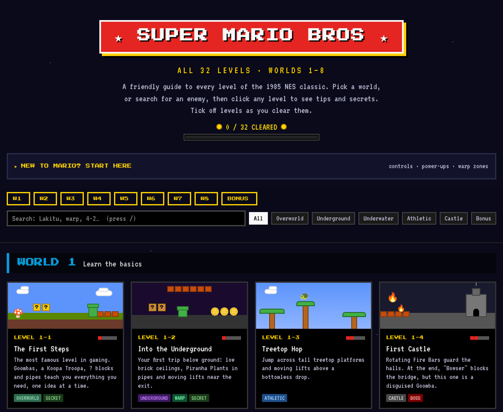

# 🍄 Super Mario Bros. Level Guide

A beginner-friendly guide to all **32 levels** of the original *Super Mario Bros.* (NES, 1985).
It covers what to expect in each level, which enemies show up, a tip for first-time players,
and where the secrets and Warp Zones are.

It's a single static web page with no build step, no framework and nothing to install.



## What you can do on the site

| Feature | How |
| --- | --- |
| **Learn the basics** | Open **"New to Mario? Start here"** for controls, power-ups, Warp Zones and a legend for the level cards. It opens automatically on your first visit. |
| **Browse by world** | Use the **W1 – W8** buttons in the sticky bar at the top. |
| **Search** | Press <kbd>/</kbd> and type anything: an enemy (`hammer bro`), a level (`4-2`), or a keyword (`warp`, `secret`, `night`). |
| **Filter by level type** | Click a chip: Overworld, Underground, Underwater, Athletic, Castle or Bonus. |
| **See level details** | Click any card for the full description, enemies, a beginner tip and secrets. Use <kbd>←</kbd> <kbd>→</kbd> to step through levels and <kbd>Esc</kbd> to close. |
| **Share a level** | Each level has its own link, e.g. `index.html#level-4-2`. |
| **Track your progress** | Click **Mark cleared** (or press <kbd>C</kbd>) in a level's detail view. Progress is saved in your browser only. |

## Run it locally

You only need a web browser.

```bash
git clone https://github.com/kelleyparker/SuperMarioLevelDescriptions.git
cd SuperMarioLevelDescriptions
# Then open index.html in your browser, e.g.:
open index.html        # macOS
xdg-open index.html    # Linux
start index.html       # Windows
```

You can also run a small local server if you prefer, e.g. `python3 -m http.server`, and then visit
<http://localhost:8000>.

### Publish it with GitHub Pages

In the repository, go to **Settings → Pages**, set **Source** to *Deploy from a branch*, pick
`main` and `/ (root)`, then save. The site will be available at
`https://<your-username>.github.io/SuperMarioLevelDescriptions/`.

## Project structure

```
index.html              Page layout: header, beginner's guide, toolbar, footer
css/styles.css          All styling (retro pixel look, cards, dialog, mobile layout)
js/levels.js            ⭐ The level data: edit this to change any level's text
js/app.js               Builds the page from the data (cards, search, dialog, progress)
scripts/check-levels.js Checks js/levels.js for mistakes (run with Node.js)
```

## Editing levels

All level content is in [`js/levels.js`](js/levels.js). You don't need to touch the HTML or
JavaScript to fix a description. Each level looks like this:

```js
{
  id: "4-2",                         // World-Level number
  name: "Twin Warp Zones",           // A short nickname shown on the card
  type: "underground",               // overworld | underground | underwater | athletic | castle | bonus
  tags: ["warp", "secret"],          // optional extras: night | warp | secret | boss | maze
  difficulty: 3,                     // 1 (easy) to 5 (hard)
  desc: "One or two sentences describing the level.",
  enemies: ["Buzzy Beetle", "Goomba"],
  tip: "One practical tip for a first-time player.",
  secret: "Optional: hidden blocks, vines, Warp Zones…",
},
```

After editing, check your changes:

```bash
node scripts/check-levels.js
```

It reports unknown types or tags, missing fields, and out-of-range difficulty ratings.
The same check runs automatically on every push and pull request.

> **Level names** (like "Twin Warp Zones") are fan nicknames to make levels easier to remember.
> Nintendo only numbers the levels (1-1, 1-2, …).

## Contributing

Fixes and improvements are welcome, especially corrections to level facts.

1. Fork the repo and create a branch: `git checkout -b fix-7-4-description`
2. Make your change (usually in `js/levels.js`).
3. Run `node scripts/check-levels.js` and open `index.html` to check it looks right.
4. Open a pull request that briefly explains what you changed. If you're correcting a fact,
   mention your source.

Ideas for contributions:

- More detailed secrets (exact hidden-block locations, 1-Up spots)
- Notes on the harder "second quest" you unlock after beating 8-4
- Accessibility or mobile layout improvements

## Credits

Unofficial fan project. *Super Mario Bros.* and all related names are trademarks of Nintendo.
This site is not affiliated with or endorsed by Nintendo.
Fonts: [Press Start 2P](https://fonts.google.com/specimen/Press+Start+2P) and
[VT323](https://fonts.google.com/specimen/VT323) from Google Fonts.
